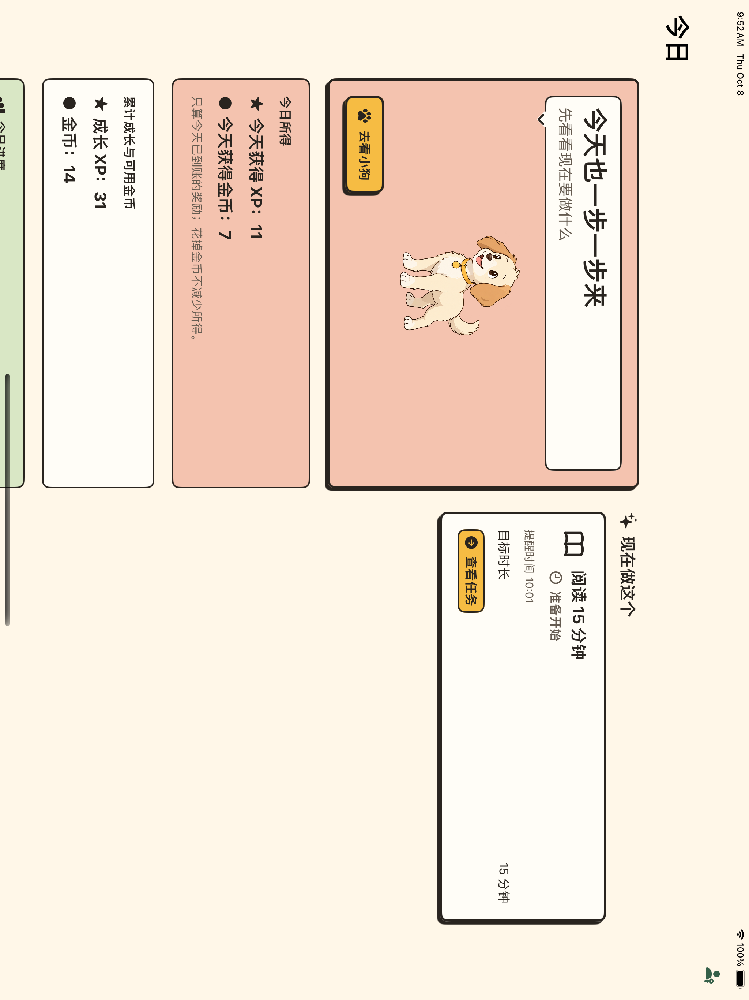
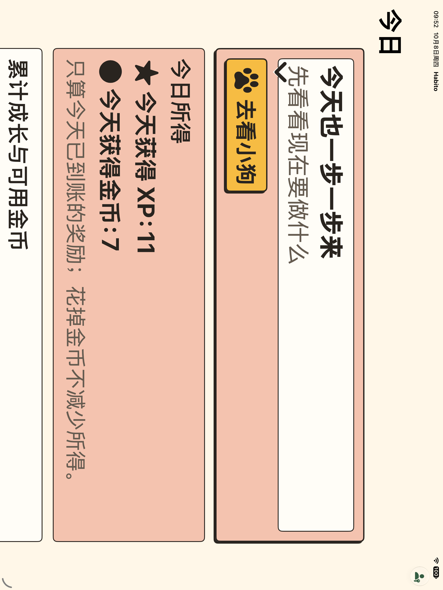
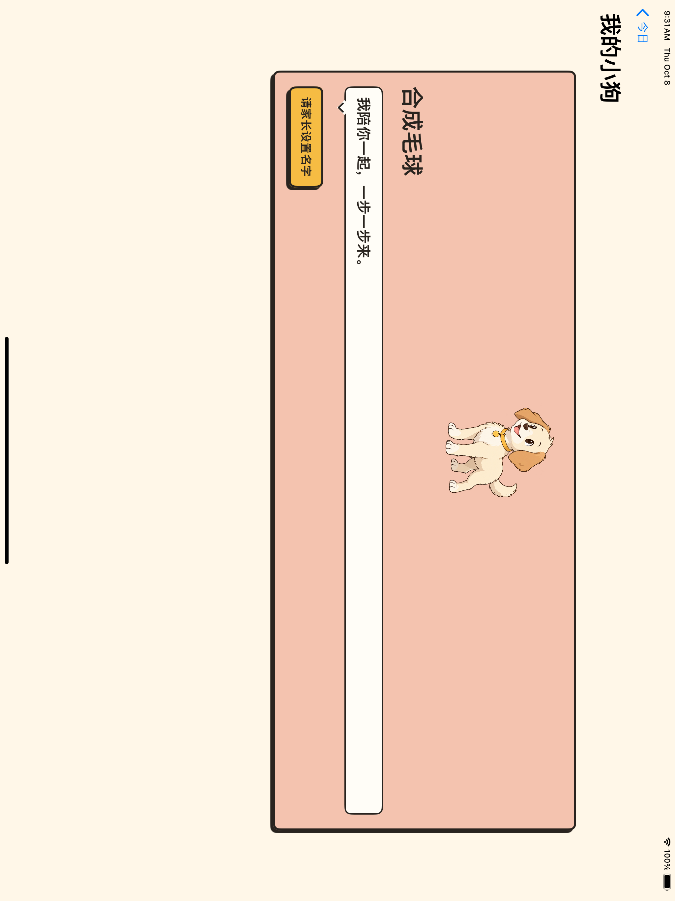
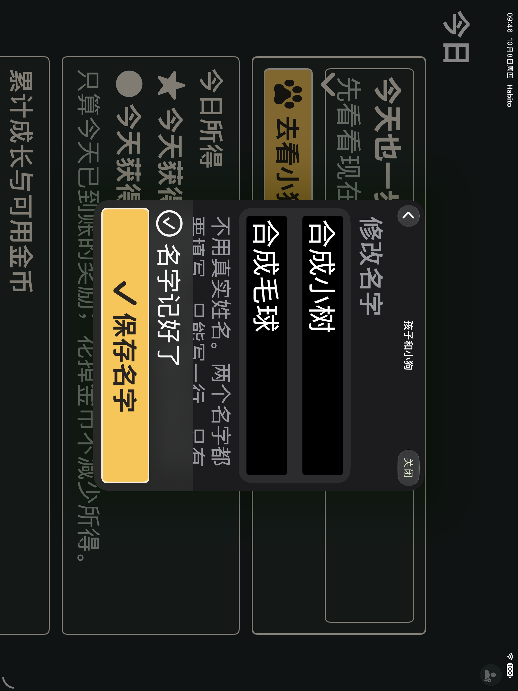

# Habito UI-R1 当前阶段验收

> 2026-10-08。当前可执行UI阶段集成回归已完成，冻结代码为 `39c8f1c`。这份报告只覆盖已经实现的界面与今日所得查询；不是宠物经济、喂食或真机的最终放行。

## 已落地内容

| 范围 | 结果 | 复用的业务边界 |
|---|---|---|
| 漫画基础 | 同一套纸色/墨色、分格、气泡、印章、主按钮、默认与庆祝小狗 | 仅展示层；减少动态与实际事件资格保持 |
| 任务图标 | Tabler v3.49.0，固定5个SVG、MIT许可；家长与儿童复用 | 历史SF Symbols存储tag不迁移，未知tag回退清单图标 |
| 儿童首页与任务执行 | 推荐/分组、计时、等待、普通/自主完成、审核收据与当天仪式统一 | 原查询、完成、撤销、审核、收据claim和通知服务 |
| 今日所得 | 按当地实际入账日，只计未冲正奖励；消费不减少所得 | RewardLedgerSnapshot验证全部账本；不补奖、不写账 |
| 累计资产 | 累计有效XP与可用金币独立展示；与今日所得的错误分开 | 原RewardLedgerService余额查询 |
| 小狗主页 | 首页角色卡入口、真实名字、未设置引导、读取失败重试 | FamilyProfileService；编辑继续经过原PIN入口，返回后刷新 |
| 家长端 | 品牌色、主要按钮、任务图标与审核框统一 | 原系统表单、固定保存栏、统计和导航，未复制业务用例 |

所有新文字位于独立的 `UIR1.xcstrings`。原 `Localizable.xcstrings` 的467个键与翻译值保持；未归属排版/提取元数据改动保留，不混入阶段提交。

## 当前口径与假设

- 今日所得以注入日历/时区的本地日界为准，包含日开始和查询时刻，不含次日或未来交易。次日审核按通过入账日计算。
- 当前账本已经冲正的奖励排除；这不是历史余额快照，系统时间回拨不会让已冲正的奖励重新有效。
- 消费只影响可用金币。读取损坏、脏上下文或所得溢出时显示独立错误，不冒充零值。
- 小狗形象/配色沿用已展示样稿的可调整假设；没有把未回答的偏好问题当成已确认。
- 小狗插画只作陪伴/庆祝装饰，不代表已实现心情、亲密度或等级。

## 验证证据

### 当前冻结源

- 代码提交：`39c8f1c`，只允许报告/看板改动；指纹记录 `/tmp/habito-ui-007a-source.json`。
- 两系完整单测各657定义/1321执行、83套件通过；各5条跨页UI专项通过。每个原生结果包合计662定义/1326执行，0失败、0跳过，xcodebuild退出0。
- 结果包：`/tmp/habito-ui-007a-17.xcresult`、`/tmp/habito-ui-007a-27-max.xcresult`；[摘要与截图指纹](ui-r1/native/stage-verification.json)。两包自然结束，没有中断诊断或测试。
- 529个冻结源文件指纹一致；原字符串表467个键及翻译语义一致。27模拟器已恢复large/light并读回，17保持large。既有R-009全屏/方向系统提示保留，无新增Swift或严格并发警告。
- 17普通专项：通知替换当前导航、计时重启完成撤销、时间段分组、今日所得、小狗设置返回与重启。
- 27真实最大辅助字号专项：完成反馈继续、时间段分组、今日所得、小狗设置返回与重启、普通完成统计。
- 本阶段使用当前影响范围专项；全部功能后的完整UI/MAX仍留第7组，不能将这些专项说成全部66条UI已重跑。
- Release应用构建与Debug静态分析已通过：`/tmp/habito-ui-r1-release-build.log`、`/tmp/habito-ui-r1-analysis.log`。

### 卡级证据

| 小卡 | 确定性单测（每系） | 真实UI与视觉 |
|---|---|---|
| 003C 执行与奖励 | 40定义/105执行 | 普通3、MAX4、截图采集补验；[记录](ui-r1/native/reward-verification.json) |
| 004A 今日所得查询 | 41定义/71执行相关测试 | 午夜、DST23/25小时、真实跨日审核、消费/冲正、溢出/损坏/脏上下文；无新UI |
| 004B 今日所得展示 | 34定义/79执行 | 17普通3、27MAX3+最终修订补验1；[记录](ui-r1/native/daily-income-verification.json) |
| 005A 小狗主页 | 27定义/55执行 | 两系各2条设置/重试；[记录](ui-r1/native/pet-verification.json) |
| 006A 家长与辅助状态 | 36定义/118执行 | 两系各4条（2条品牌路径+2条最终保存栏补验）；[记录](ui-r1/native/parent-verification.json) |

不同卡和补验的覆盖边界分别保留，不把历史包合称一次最终整包。普通/MAX测试均使用隔离合成数据库，不读取正式家庭数据或真实PIN。

### 已发现并修复的问题

1. 004A首轮测试误用队列字段名：改为实际 `id`，双系编译与全部相关测试通过。
2. 004B新字符串表默认语言错误：英文系统显示资源键名。改为项目默认 `zh-Hans`，用独立构建目录补验。
3. 005A新系统导航栏宠物按钮只有36pt：改为首页角色卡中的44pt以上漫画按钮；没有放宽热区断言。
4. 005A测试滚动助手不认识宠物页：增加精确导航标题与无固定保存栏分支，继续要求完整可见。
5. 006A深色品牌tint对原主要按钮有低对比风险：主要按钮显式使用漫画文字色/背景，并补验名字和任务固定保存栏。
6. 首次Release方案级分析包含需要 `@testable` 的测试目标而失败：应用Release构建成功，之后分开执行Release build与Debug analyze，均退出0，没有关闭检查。

部分Xcode测试结束后停留在600秒可选 `simctl diagnose`。只对确认属于该次测试且测试已结束的诊断子进程发送SIGINT，保留测试结果与原始失败包；没有用中断把失败变成通过。

## 原生截图

下图来自隔离模拟器，不是生成的产品效果图。MAX截图只代表采集时的滚动位置，完整可见性另外由实际UI断言验证。

## 尚未完成与下一入口

总工作组进度仍为 **3/7**。UI小卡不能直接替代功能组完成。

| 剩余组 | 已有基础 | 尚缺 |
|---|---|---|
| 第3组 宠物/首次设置 | 原子名字保存、PIN后配置、只读宠物主页与未设置引导 | 宠物成长数值及相关首次状态 |
| 第4组 喂食 | 可用Coin账本、原子消费入口、统一角色 | 价格/效果确认后，喂食记录与扣款事务、幂等/失败恢复、真实喂食UI |
| 第6组 正反馈整合 | 完成/审核收据、当天仪式、真实今日所得 | 等级提升及喂食反馈与真实事实连接 |
| 第7组 总体验收 | 当前功能与UI自动化分阶段证据 | 上述功能齐备后的完整联合回归，目标iPad/系统开关/VoiceOver及家庭观察 |

此前已异步提出、尚未确认的最小数值候选：每累计100有效XP升1级；一种食物5Coin/份；每次喂食亲密度+1；当天喂过为“开心”，新一天“平静”；不衰减亲密度、不设饥饿惩罚。**这些数值尚未启用，也未进入生产模型。** 等用户选择采用或调整后再拆相应迁移/事务小卡，不借视觉工作代定经济规则。

2026-10-08 09:54只读设备枚举确认目标实机iPad(A16)、iPadOS26.6仍为unavailable；连接中的两台iPad均为模拟器。真机送达、系统开关与家庭观察仍按原约定后置，不以模拟器代验。声音/触觉、连续天数、成就和玩具仍不在本轮范围。
