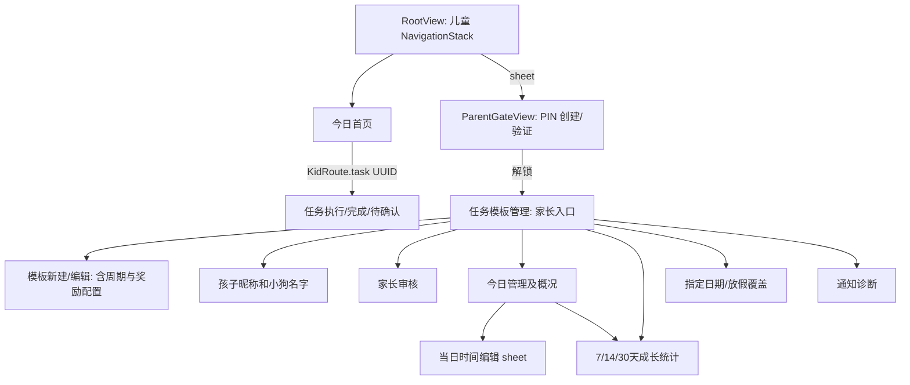

# Habito UI-R1 页面盘点与迁移地图

> UI-R1-001，2026-10-08。依据实际源3b1d45f（回归文档提交dd4f745）与DEC-031。仅盘点，不表示漫画视觉已经实现。总体功能进度仍【3/7】。

## 1. 执行结论

提前做共用视觉系统、角色母版和首页样板，再让未实现的首次设置/宠物/喂食/成长页面直接采用新UI。已完成审核、账本、收据、名字保存、统计与当天仪式继续复用。既有页面迁移以展示层为主，不因“漫画化”复制服务或新增持久化模型。

源扫描共72个直接声明View的Swift文件（含泛型自适应布局）；详见完整附件。54个文件包含#Preview，这仅是预览入口数量，不代表所有状态、尺寸和无障碍均已覆盖。资源目录当前只有Localizable.xcstrings；未发现已接入的小狗/食物/漫画插画或统一第三方图标资源。固定字符串调用中有46种SF Symbols，动态任务图标另由持久化标识传入。

## 2. 实际导航

证据：[RootView](../Habito/App/RootView.swift)、[KidRoute](../Habito/Features/Today/KidRoute.swift)、[ParentGateView](../Habito/Features/ParentGate/ParentGateView.swift)、[ParentRoute](../Habito/Features/ParentGate/ParentRoute.swift)。当前家长“首页”实际是任务模板管理入口，不另造一套管理导航。通知点击通过Root路由到任务或首页，视觉迁移必须保留该入口。通知探针是开发验证界面，未在当前正式Root导航挂载。

## 3. A：核心儿童体验重构

A指重新设计界面布局和视觉，不表示重写业务内核。

| 页面/区域 | 当前实现与状态 | 直接复用 | UI-R1改造与关键保护 |
|---|---|---|---|
| 今日首页/招呼/进度 | Today下KidTodayView、KidTodayGreetingPanel、KidTodayProgressView；加载/正常/空/失败 | TodayViewModel、TodayTaskQueryService、TodayScreenContent | 漫画“一话”结构、角色气泡、真实完成数；日期/话数不可隐含新连续签到规则，装饰不挤走行动入口 |
| 推荐任务/其余任务组/任务卡 | KidTodayLoadedView、KidTaskCard、KidTaskListRow、KidTodayTaskGroupView；四时段、跨日暂停、完成/待确认等 | 已投影分组、稳定实例ID、推荐唯一性、KidTaskTimingPresentation | 漫画Panel、图标和时间语义；推荐不重复，所有组可滚动可读，待确认不能算完成；保留已验证VStack无障碍兼容方案 |
| 资产概览 | KidTodayRewardOverview、KidRewardAmountView；加载/余额/失败独立于任务 | TodayRewardState.loaded(RewardBalance) | 统一XP/Coin视觉；当前是累计资产，不改名为“今日所得”。读失败不能显示0，也不能阻挡任务 |
| 任务执行/计时 | KidTaskSessionView、TaskSessionLoadedView及身份/计时/操作组件；未开始/运行/暂停/完成/失败 | TaskSessionViewModel/Factory、TaskSessionScreenContent及注入时钟 | 任务冒险分格；开始/暂停/继续/打卡意图保持。五秒撤销独立可达，不因庆祝挤到几屏之后；不改后台计时恢复 |
| 普通/自主完成反馈 | TaskSessionResultFeedbackView、TaskCompletionCelebrationView、RewardCard、Snapshot、Undo；含零奖励 | TaskSessionCompletionFeedback、TaskSessionFeedbackPresentation/Motion、真实完成收据 | CLEAR/自主印章有中文主文案；金额来自收据，自主额外奖励仍只按当前Coin规则；关闭不撤销、不再结算 |
| 提交/等待/退回/稍后提醒 | TaskSubmissionStatusView、TaskSessionFeedbackCard、TaskSnoozeFeedbackView | 提交快照、TaskSnoozeState和通知服务 | 等待与已到账清楚区分；退回保留时长并可继续；逾时不用恐吓/红屏，也不能变更原提醒与截止语义 |
| 审核后儿童收据 | ChildRewardFeedbackView；逐条展示、读取失败、确认失败重试 | ChildRewardFeedbackViewModel、ChildRewardReceiptService与稳定ID | 非模态漫画奖励反馈；明确继续才已读，导航/刷新/重启不自动确认；金额/跨日自主性来自原快照 |
| 当天通关/庆祝失败 | KidTodayCompletionView、TodayCompletionCelebrationView、TodayCompletionVerificationErrorView | TodayCompletionCelebrationViewModel的事件、claim、dismiss、独立refresh | 多格视觉可复用同ID去重；正文/继续首帧可用、Reduce Motion静态；空/全跳过/等待不伪通关、不加通关奖励 |

儿童空态/关键错误态由以上对应区域承载，随页面改造，不另建平行状态机。

## 4. B：保留结构的共用与辅助区域

| 区域 | 文件/现状 | 处理 |
|---|---|---|
| 根导航和生命周期 | App/RootView.swift | 保留类型路由、家长sheet关闭刷新、通知导航、场景恢复和依赖注入；漫画样板先从子View接入 |
| 容器自适应 | Shared/Layout/AdaptiveTwoColumnLayout.swift | 现有宽容器双栏、辅助字号单栏可复用；按容器判断，不能改为固定iPad像素或横屏强制双栏 |
| 三种时间语义 | Shared/TaskTiming/KidTaskTimingView.swift及Presentation | 提醒/计划/截止分别保留，未设保持nil；时间徽标只改外观，不改变自主奖励口径 |
| 通用错误、空态、普通反馈/对话框 | 附着在所属A/C页面 | 统一按钮/标题/Panel语义，但保留错误可重试、字段反馈和系统权限提示的用途；不集中改成全屏漫画 |
| 历史记录/独立儿童辅助详情 | 当前无独立正式路由 | 不把PRD候选写成已存在页面；若后续需要，先明确功能卡，不在UI改造时顺手添加 |

## 5. C：家长效率优先

| 页面 | 源入口与状态范围 | 复用/改造边界 |
|---|---|---|
| PIN门禁 | ParentGateView/Model；加载、创建、验证、解锁、失败、本机重置确认 | Keychain及本次解锁语义保持；系统安全字段/焦点/错误反馈优先，少量品牌标题与图标 |
| 任务模板管理 | ParentTaskTemplateListView/Content/Row；空/加载/正常/失败 | 原List和导航保持，统一图标/色彩/分区。不能提前读取PIN后的私人统计或名字 |
| 模板新建/编辑 | TaskTemplateEditorView/Form、Configuration/Time/RewardSection、SaveBar | 周期、分类、时段、审核方式、奖励与三个时间是现有表单区；不用再建重复“周期设置/奖励设置”页面。保留字段错误与历史快照保护、停用/归档确认 |
| 今日管理/概况 | ParentTodayTaskListView/Body、ParentTodayOverviewView、ParentTodayTimeEditorView | 概况和跳过/恢复/更正/改时继续走现有服务；大字号表单/命中区域保持；时间sheet不变成新的计时业务 |
| 指定日期/放假 | ParentCalendarDayView/Content | 影响预览、确认、取消与错误反馈保持；不为装饰改写跨日与放假规则 |
| 家长审核 | ParentReviewView/Content/QueueRow/Snapshot/Feedback | 待审核列表、原快照、通过/退回及失败恢复保持；动作效力和真实奖励不能被漫画分镜延迟 |
| 基础统计 | GrowthStatisticsView/Body、PeriodButtons、TrendRow等 | 7/14/30天、未知值、空与失败状态、展开及PIN前不加载保持；图表/标签可品牌化，不创造新指标 |
| 名字设置 | FamilyProfileEditorView/Form/SaveBar/Feedback | 当前是PIN后可选编辑，未配置/加载失败分开、双名字原子保存、失败保留草稿；与未来首次引导共用FamilyProfileService，不重复模型 |
| 通知状态/诊断 | ParentNotificationDiagnosticsView、NotificationSchedulingStatusView | 保留权限/排程/部分失败各自状态、重试和系统设置入口；系统说明不漫画化遮蔽 |
| 通知开发探针 | NotificationProbeView | 验证工具保留，非儿童产品页，不为本轮风格投入重构 |

家长端“系统设置”目前分散在门禁、通知等既有入口，不凭概念稿添加一个无需求的新设置中心。

## 6. 尚未实现的界面与依赖

| 新增体验 | 已有基础 | 必须先解决 | 排期 |
|---|---|---|---|
| 首次孩子/小狗引导 | FamilyProfileNames、FamilyProfileService、ChildProfile/Pet、PIN | 旧家庭可继续使用、PIN与首次流程的接续规则；不重复创建名字服务 | 首页样板后直接漫画UI；对应功能前定义引导卡 |
| 宠物主页/点击互动 | Pet当前只存固定业务键和名字 | 角色主形象/表情；互动含义、成长/情绪规则尚未确认，不能擅填Lv.1/Bond/Mood | 新视觉基础后建设，不先写旧样式 |
| 喂食/食物选择 | 账本基础、宠物名字 | 食物价格/效果、扣币与幂等/失败回滚等独立业务验收 | 参数明确后领域事务与新UI分卡协作，界面只做一套 |
| 等级/升级/成长反馈 | XP余额和既有完成反馈边界 | 等级阈值、成长关系、升级事件去重；小狗动作母版 | 对应规则明确后，与第6组合并 |
| 今日收益摘要 | 可查询账本、已有资产区 | 以交易日还是任务日归属、跨日审核/冲正/消费展示口径 | 独立定义口径后实现；不把余额当今日所得 |

Streak、成就、玩具、音效/触觉仍后置。样稿里的图像不得悄悄把这些变为P0需求；角色表情也不等于新增饥饿惩罚机制。

## 7. 共用视觉、图标与资源

- 令牌唯一演进点：[HabitoDesign](../Habito/DesignSystem/HabitoDesign.swift)。已有Spacing、CornerRadius、Layout、Palette、Symbol、Feedback；002A先定义漫画纸色/墨色/语义反馈/描边/阴影等候选，样稿验证后逐页接入。避免第一步全局替色导致家长表单与现有反馈一起变化。
- 主图标体系按DEC-031采用[Tabler](https://github.com/tabler/tabler-icons)，静态矢量按需打包；系统导航/关闭/编辑等继续用SF Symbols，XP/Coin/狗粮/特效再定制。002A固定版本、许可与映射，不安装运行时包。
- 持久化任务图标当前允许book.fill、pencil.line、figure.run、music.note；颜色标识task、reading、practice、activity。展示适配器映射新图，不改存储tag、历史实例快照或编辑草稿；未知旧标识需要明确回退。图标颜色不能独自表达状态。
- 首批组件只覆盖真实需求：漫画Panel、气泡、主/次按钮、状态印章、资产展示及角色容器。内容不烘焙在图片里；中文正文使用系统语义字体。
- 角色先母版与三类样稿，再默认/开心/鼓励/庆祝资源；吃饭/升级随对应功能补齐。目录建议在现有Resources下组织资源目录，配套来源/许可证；确定Xcode资源格式后再落地，当前不创建空资产体系。
- 预览必须按组件实际状态补齐普通/MAX、横屏/窄容器、长文、浅/深色和减少动态。已有54个含Preview文件不等于通过完整视觉验收。

## 8. 必须保留的测试与兼容证据

现有[HabitoKidFlowUITests](../HabitoUITests/HabitoKidFlowUITests.swift)有63个UI用例，37个重点MAX；B3C两系已按原包加精准补验完成覆盖。UI迁移每卡只运行受影响专项，最终与第7组联合全量；不因换定位删除业务/金额/热区断言。

| 改造面 | 优先保护的现有方法/证据 |
|---|---|
| 首页/分组/推荐 | `testFormalTimePeriodGroupsKeepRecommendationUniqueAndTasksReachableWithSystemTextSize`、`testTwoDayPausedTaskKeepsIdentityAndTodayDenominatorWithSystemTextSize`；空首页与通知物化刷新 |
| 完成/撤销/奖励 | `testSelfConfirmShowsActualRewardsOnceAndUndoRemainsReachable`、`testCompletionCelebrationRewardsAndContinueRemainReachableWithSystemTextSize`；普通/自主/零奖励/期限专项 |
| 审核收据/仪式互不误确认 | `testMultipleFormalApprovedReceiptsContinueIndividuallyWithoutDoubleRewardsWithSystemTextSize`、`testApprovalReceiptAndDailyCelebrationCloseIndependentlyWithSystemTextSize`、`testDailyQualificationFailureDoesNotUndoSavedCompletionAndCanRetryWithSystemTextSize` |
| 名字/首次引导复用 | `testFamilyNamesSaveEditPINAndRestartWithSystemTextSize`、`testFamilyNamesReadFailureRetryOnlyAfterPINWithSystemTextSize`、`testFamilyNamesSaveFailureKeepsDraftAndRetriesAcrossRestartWithSystemTextSize` |
| 家长表单/统计 | `testFormalConfiguredTemplateProtectsSubmittedRewardThroughEditApprovalAndRestart`、`testFormalStatisticsOverviewWaitingApprovalSkipAndRestartWithSystemTextSize`及输入错误/旧配置/时间保护 |
| 导航/系统入口 | 通知冷启动与前台替换导航、PIN重开、通知权限关闭但任务可完成 |

已验证的非直观兼容处理必须先理解再动：首页任务组用VStack保持新系统AX树；任务执行页撤销栏与滚动内容分配独立空间；家长时间滚轮/导航式Picker满足44pt；家长sheet关闭清理私人状态。相关代码都有原因注释，不能为了统一视觉直接删除。

SwiftUI基线继续用swiftui-pro导航/数据/无障碍规则，iPadOS17、严格并发、Dynamic Type、VoiceOver语义、Reduce Motion及44pt。R-009新系统全屏/方向提醒仍是历史兼容待办；真实设备、系统开关/读屏和家庭体验另验。

## 9. 下一阶段与本卡验收

近期正式小卡见[UI-R1任务卡](Habito-UI-R1-任务卡.md)：001盘点 → 002A视觉规格/图标映射 → 002B角色母版/首页·奖励·宠物样稿。主形象与样稿收到用户实际确认后再批量资产和产品接线；后续工作包按样稿和业务依赖拆小卡。远期候选不加入已完成分母。

本卡核对：实际Root/ParentRoute路由与页面地图一致；72个View文件均进入附件；引用的源文件和测试方法存在；A/B/C与未实现分开；没有新增经济规则/依赖/源代码。本卡为代码与文档盘点，未把静态检查当新视觉的截图或运行验收。

## 附件：全部View文件分类

A=儿童核心，B=保留结构的共用容器，C=家长效率/验证页。功能内的小组件跟随所属页面迁移，避免为每个子View新建一张任务卡。“有Preview”仅代表该文件包含预览声明。

| 文件 | 类别 | 有Preview |
|---|---|---|
| [Habito/App/RootView.swift](../Habito/App/RootView.swift) | B | 否 |
| [Habito/Features/FamilyProfile/FamilyProfileEditorFeedbackView.swift](../Habito/Features/FamilyProfile/FamilyProfileEditorFeedbackView.swift) | C | 是 |
| [Habito/Features/FamilyProfile/FamilyProfileEditorForm.swift](../Habito/Features/FamilyProfile/FamilyProfileEditorForm.swift) | C | 是 |
| [Habito/Features/FamilyProfile/FamilyProfileEditorSaveBar.swift](../Habito/Features/FamilyProfile/FamilyProfileEditorSaveBar.swift) | C | 是 |
| [Habito/Features/FamilyProfile/FamilyProfileEditorView.swift](../Habito/Features/FamilyProfile/FamilyProfileEditorView.swift) | C | 是 |
| [Habito/Features/GrowthStatistics/GrowthStatisticsBody.swift](../Habito/Features/GrowthStatistics/GrowthStatisticsBody.swift) | C | 是 |
| [Habito/Features/GrowthStatistics/GrowthStatisticsCountsView.swift](../Habito/Features/GrowthStatistics/GrowthStatisticsCountsView.swift) | C | 是 |
| [Habito/Features/GrowthStatistics/GrowthStatisticsPeriodButtons.swift](../Habito/Features/GrowthStatistics/GrowthStatisticsPeriodButtons.swift) | C | 是 |
| [Habito/Features/GrowthStatistics/GrowthStatisticsRateView.swift](../Habito/Features/GrowthStatistics/GrowthStatisticsRateView.swift) | C | 是 |
| [Habito/Features/GrowthStatistics/GrowthStatisticsTaskSection.swift](../Habito/Features/GrowthStatistics/GrowthStatisticsTaskSection.swift) | C | 是 |
| [Habito/Features/GrowthStatistics/GrowthStatisticsTrendRow.swift](../Habito/Features/GrowthStatistics/GrowthStatisticsTrendRow.swift) | C | 是 |
| [Habito/Features/GrowthStatistics/GrowthStatisticsView.swift](../Habito/Features/GrowthStatistics/GrowthStatisticsView.swift) | C | 否 |
| [Habito/Features/NotificationProbe/NotificationProbeView.swift](../Habito/Features/NotificationProbe/NotificationProbeView.swift) | C | 是 |
| [Habito/Features/ParentCalendar/ParentCalendarDayContent.swift](../Habito/Features/ParentCalendar/ParentCalendarDayContent.swift) | C | 否 |
| [Habito/Features/ParentCalendar/ParentCalendarDayPreview.swift](../Habito/Features/ParentCalendar/ParentCalendarDayPreview.swift) | C | 是 |
| [Habito/Features/ParentCalendar/ParentCalendarDayView.swift](../Habito/Features/ParentCalendar/ParentCalendarDayView.swift) | C | 否 |
| [Habito/Features/ParentGate/ParentGateView.swift](../Habito/Features/ParentGate/ParentGateView.swift) | C | 否 |
| [Habito/Features/ParentNotifications/NotificationSchedulingStatusView.swift](../Habito/Features/ParentNotifications/NotificationSchedulingStatusView.swift) | C | 是 |
| [Habito/Features/ParentNotifications/ParentNotificationDiagnosticsPreview.swift](../Habito/Features/ParentNotifications/ParentNotificationDiagnosticsPreview.swift) | C | 是 |
| [Habito/Features/ParentNotifications/ParentNotificationDiagnosticsView.swift](../Habito/Features/ParentNotifications/ParentNotificationDiagnosticsView.swift) | C | 否 |
| [Habito/Features/ParentReview/ParentReviewActionErrorMessageView.swift](../Habito/Features/ParentReview/ParentReviewActionErrorMessageView.swift) | C | 是 |
| [Habito/Features/ParentReview/ParentReviewContentView.swift](../Habito/Features/ParentReview/ParentReviewContentView.swift) | C | 是 |
| [Habito/Features/ParentReview/ParentReviewFeedbackView.swift](../Habito/Features/ParentReview/ParentReviewFeedbackView.swift) | C | 是 |
| [Habito/Features/ParentReview/ParentReviewQueueRow.swift](../Habito/Features/ParentReview/ParentReviewQueueRow.swift) | C | 是 |
| [Habito/Features/ParentReview/ParentReviewSnapshotView.swift](../Habito/Features/ParentReview/ParentReviewSnapshotView.swift) | C | 是 |
| [Habito/Features/ParentReview/ParentReviewView.swift](../Habito/Features/ParentReview/ParentReviewView.swift) | C | 是 |
| [Habito/Features/ParentTaskTemplates/ParentTaskTemplateListContent.swift](../Habito/Features/ParentTaskTemplates/ParentTaskTemplateListContent.swift) | C | 是 |
| [Habito/Features/ParentTaskTemplates/ParentTaskTemplateListView.swift](../Habito/Features/ParentTaskTemplates/ParentTaskTemplateListView.swift) | C | 否 |
| [Habito/Features/ParentTaskTemplates/ParentTaskTemplateRow.swift](../Habito/Features/ParentTaskTemplates/ParentTaskTemplateRow.swift) | C | 否 |
| [Habito/Features/ParentTaskTemplates/TaskTemplateConfigurationSection.swift](../Habito/Features/ParentTaskTemplates/TaskTemplateConfigurationSection.swift) | C | 是 |
| [Habito/Features/ParentTaskTemplates/TaskTemplateEditorForm.swift](../Habito/Features/ParentTaskTemplates/TaskTemplateEditorForm.swift) | C | 是 |
| [Habito/Features/ParentTaskTemplates/TaskTemplateEditorSaveBar.swift](../Habito/Features/ParentTaskTemplates/TaskTemplateEditorSaveBar.swift) | C | 是 |
| [Habito/Features/ParentTaskTemplates/TaskTemplateEditorView.swift](../Habito/Features/ParentTaskTemplates/TaskTemplateEditorView.swift) | C | 否 |
| [Habito/Features/ParentTaskTemplates/TaskTemplateRewardField.swift](../Habito/Features/ParentTaskTemplates/TaskTemplateRewardField.swift) | C | 是 |
| [Habito/Features/ParentTaskTemplates/TaskTemplateRewardSection.swift](../Habito/Features/ParentTaskTemplates/TaskTemplateRewardSection.swift) | C | 是 |
| [Habito/Features/ParentTaskTemplates/TaskTemplateTimeSection.swift](../Habito/Features/ParentTaskTemplates/TaskTemplateTimeSection.swift) | C | 是 |
| [Habito/Features/ParentToday/ParentTodayOverviewView.swift](../Habito/Features/ParentToday/ParentTodayOverviewView.swift) | C | 是 |
| [Habito/Features/ParentToday/ParentTodayTaskListBody.swift](../Habito/Features/ParentToday/ParentTodayTaskListBody.swift) | C | 是 |
| [Habito/Features/ParentToday/ParentTodayTaskListView.swift](../Habito/Features/ParentToday/ParentTodayTaskListView.swift) | C | 否 |
| [Habito/Features/ParentToday/ParentTodayTaskRow.swift](../Habito/Features/ParentToday/ParentTodayTaskRow.swift) | C | 是 |
| [Habito/Features/ParentToday/ParentTodayTimeEditorView.swift](../Habito/Features/ParentToday/ParentTodayTimeEditorView.swift) | C | 否 |
| [Habito/Features/TaskSession/KidTaskSessionView.swift](../Habito/Features/TaskSession/KidTaskSessionView.swift) | A | 否 |
| [Habito/Features/TaskSession/TaskCompletionCelebrationView.swift](../Habito/Features/TaskSession/TaskCompletionCelebrationView.swift) | A | 是 |
| [Habito/Features/TaskSession/TaskCompletionRewardCard.swift](../Habito/Features/TaskSession/TaskCompletionRewardCard.swift) | A | 是 |
| [Habito/Features/TaskSession/TaskCompletionSnapshotView.swift](../Habito/Features/TaskSession/TaskCompletionSnapshotView.swift) | A | 是 |
| [Habito/Features/TaskSession/TaskCompletionUndoView.swift](../Habito/Features/TaskSession/TaskCompletionUndoView.swift) | A | 是 |
| [Habito/Features/TaskSession/TaskSessionActionButton.swift](../Habito/Features/TaskSession/TaskSessionActionButton.swift) | A | 是 |
| [Habito/Features/TaskSession/TaskSessionControlsView.swift](../Habito/Features/TaskSession/TaskSessionControlsView.swift) | A | 是 |
| [Habito/Features/TaskSession/TaskSessionFeedbackCard.swift](../Habito/Features/TaskSession/TaskSessionFeedbackCard.swift) | A | 否 |
| [Habito/Features/TaskSession/TaskSessionIdentityPanel.swift](../Habito/Features/TaskSession/TaskSessionIdentityPanel.swift) | A | 是 |
| [Habito/Features/TaskSession/TaskSessionLoadedView.swift](../Habito/Features/TaskSession/TaskSessionLoadedView.swift) | A | 是 |
| [Habito/Features/TaskSession/TaskSessionResultFeedbackView.swift](../Habito/Features/TaskSession/TaskSessionResultFeedbackView.swift) | A | 是 |
| [Habito/Features/TaskSession/TaskSessionTimerPanel.swift](../Habito/Features/TaskSession/TaskSessionTimerPanel.swift) | A | 否 |
| [Habito/Features/TaskSession/TaskSnoozeFeedbackView.swift](../Habito/Features/TaskSession/TaskSnoozeFeedbackView.swift) | A | 是 |
| [Habito/Features/TaskSession/TaskSubmissionStatusView.swift](../Habito/Features/TaskSession/TaskSubmissionStatusView.swift) | A | 是 |
| [Habito/Features/Today/ChildRewardFeedbackView.swift](../Habito/Features/Today/ChildRewardFeedbackView.swift) | A | 是 |
| [Habito/Features/Today/KidRewardAmountView.swift](../Habito/Features/Today/KidRewardAmountView.swift) | A | 是 |
| [Habito/Features/Today/KidTaskCard.swift](../Habito/Features/Today/KidTaskCard.swift) | A | 是 |
| [Habito/Features/Today/KidTaskListRow.swift](../Habito/Features/Today/KidTaskListRow.swift) | A | 是 |
| [Habito/Features/Today/KidTodayCompletionView.swift](../Habito/Features/Today/KidTodayCompletionView.swift) | A | 是 |
| [Habito/Features/Today/KidTodayGreetingPanel.swift](../Habito/Features/Today/KidTodayGreetingPanel.swift) | A | 否 |
| [Habito/Features/Today/KidTodayLoadedView.swift](../Habito/Features/Today/KidTodayLoadedView.swift) | A | 是 |
| [Habito/Features/Today/KidTodayProgressView.swift](../Habito/Features/Today/KidTodayProgressView.swift) | A | 否 |
| [Habito/Features/Today/KidTodayRewardOverview.swift](../Habito/Features/Today/KidTodayRewardOverview.swift) | A | 是 |
| [Habito/Features/Today/KidTodayTaskContent.swift](../Habito/Features/Today/KidTodayTaskContent.swift) | A | 是 |
| [Habito/Features/Today/KidTodayTaskGroupView.swift](../Habito/Features/Today/KidTodayTaskGroupView.swift) | A | 是 |
| [Habito/Features/Today/KidTodayView.swift](../Habito/Features/Today/KidTodayView.swift) | A | 是 |
| [Habito/Features/Today/TodayCompletionCelebrationView.swift](../Habito/Features/Today/TodayCompletionCelebrationView.swift) | A | 是 |
| [Habito/Features/Today/TodayCompletionVerificationErrorView.swift](../Habito/Features/Today/TodayCompletionVerificationErrorView.swift) | A | 是 |
| [Habito/Shared/Layout/AdaptiveTwoColumnLayout.swift](../Habito/Shared/Layout/AdaptiveTwoColumnLayout.swift) | B | 否 |
| [Habito/Shared/TaskTiming/KidTaskTimingDetails.swift](../Habito/Shared/TaskTiming/KidTaskTimingDetails.swift) | B | 是 |
| [Habito/Shared/TaskTiming/KidTaskTimingView.swift](../Habito/Shared/TaskTiming/KidTaskTimingView.swift) | B | 否 |
