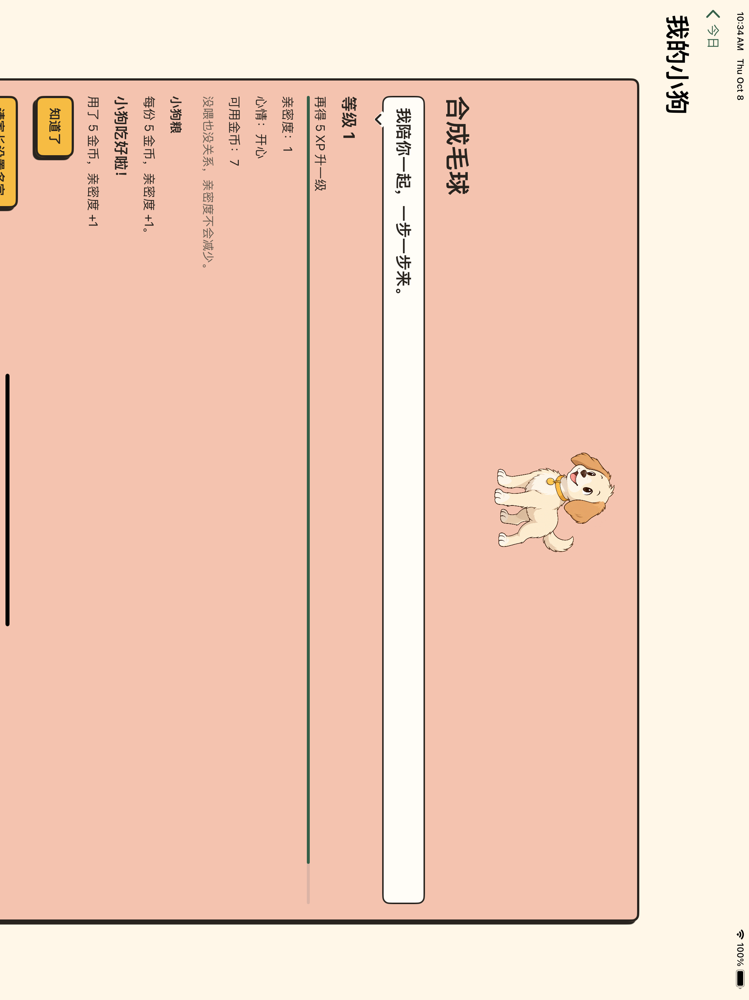
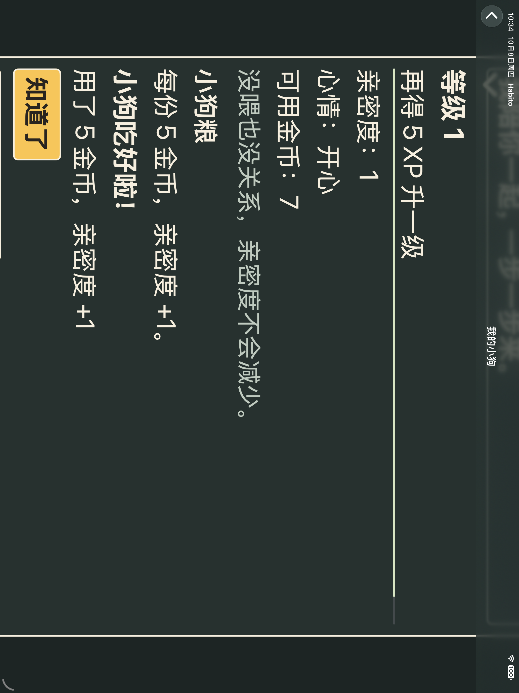

# V1 宠物功能验收

## 001A 兼容结构（2026-10-08）

冻结ac9b505的8.0.0十三实体，9.0.0只新增喂食审计和升级观察点。两系完整661定义/1328执行、84套件通过；结果包`/tmp/habito-pet-001a-fixed-17.xcresult`及`/tmp/habito-pet-001a-fixed-27.xcresult`。旧八与所有更早迁移、名字/Unicode/审核收据/账本/通知/计时关系、空库不回填、三次重开验证通过。新观察点不当成长余额，未开放业务写入。

最初工程注册的加号路径没有引号，Xcode在编译前拒绝工程；修正后两系完整重新运行通过，原001a日志保留。格式、工程解析和diff检查通过。

## 001B 成长与原子喂食（2026-10-08）

DEC-033规则集中定义；查询验证每份喂食与Coin配对，等级来自有效XP，Bond累加成功事实，Mood使用注入日历/时区。两系47定义/89执行相关测试通过，结果包`/tmp/habito-pet-001b-final-{17,27}.xcresult`。新增14定义覆盖Int.max/阈值/冲正、余额/幂等/失败恢复/脏草稿/损坏与孤立消费/DST/回拨/磁盘重开。没有另存XP/Coin余额。

初始测试宏缺内层try编译失败修复；17磁盘失败夹具曾在第二容器打开后继续对旧容器插入，出现134020，改为释放原容器作用域后重开重试。最终两系全部相关测试重跑通过，生产服务未因测试放宽事务边界。

## 001C 实际宠物UI（2026-10-08）

两系24定义/50执行单测和各3UI（摘要27定义/53执行）通过，包`/tmp/habito-pet-001c-fixed-{17,27}.xcresult`。普通17、实际深色MAX27均走通PIN设置返回/重启、两份扣款12→2且Bond0→2、余额不足禁用、保存失败无扣款并以原请求重试。每个操作明确44pt及完整可见断言；SwiftUI使用语义字、文本心情与真实金额，未知失败不冒充成功。

最初两个测试宏短路条件中的throw表达式编译失败，拆为独立断言后全部重跑通过。

