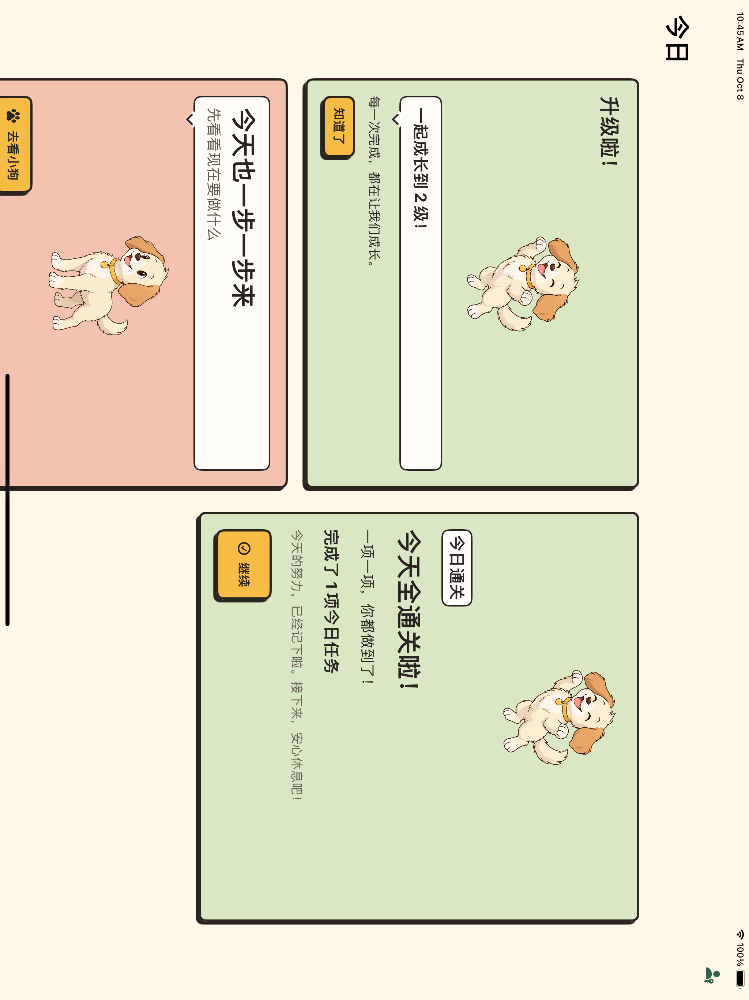
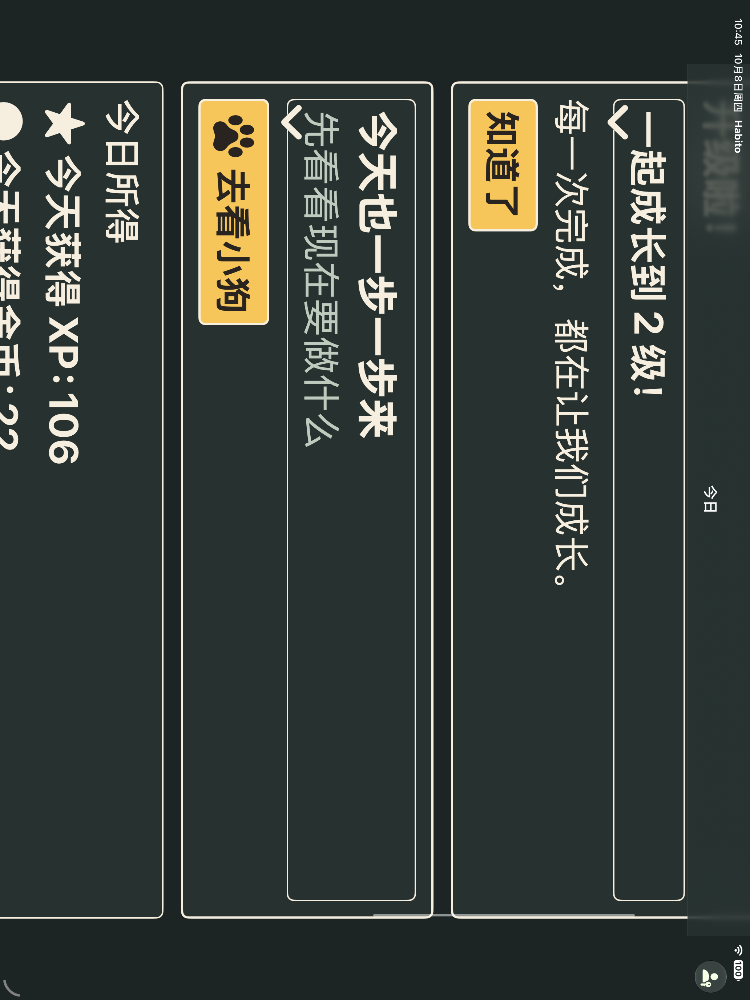
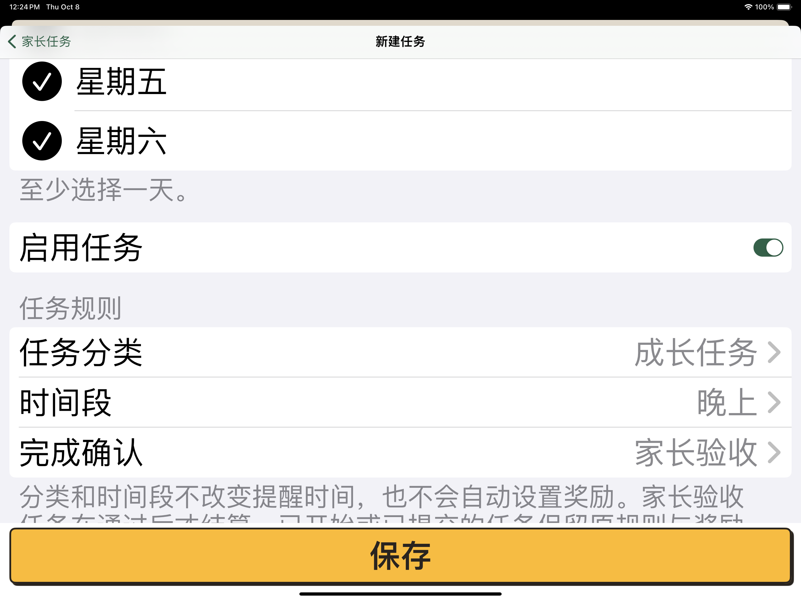
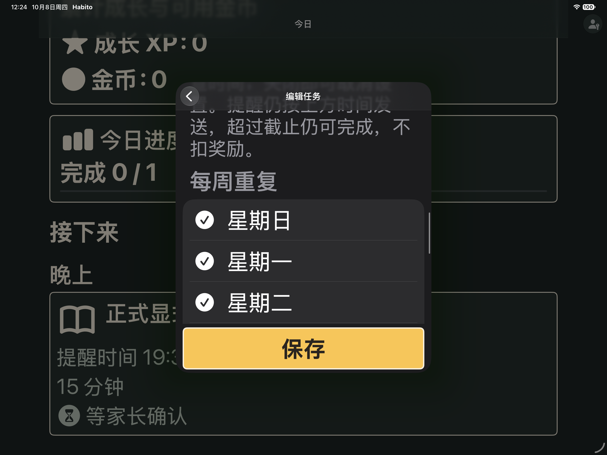

# V1 宠物功能验收

## 001A 兼容结构（2026-10-08）

冻结ac9b505的8.0.0十三实体，9.0.0只新增喂食审计和升级观察点。两系完整661定义/1328执行、84套件通过；结果包`/tmp/habito-pet-001a-fixed-17.xcresult`及`/tmp/habito-pet-001a-fixed-27.xcresult`。旧八与所有更早迁移、名字/Unicode/审核收据/账本/通知/计时关系、空库不回填、三次重开验证通过。新观察点不当成长余额，未开放业务写入。

最初工程注册的加号路径没有引号，Xcode在编译前拒绝工程；修正后两系完整重新运行通过，原001a日志保留。格式、工程解析和diff检查通过。

## 001B 成长与原子喂食（2026-10-08）

DEC-033规则集中定义；查询验证每份喂食与Coin配对，等级来自有效XP，Bond累加成功事实，Mood使用注入日历/时区。两系47定义/89执行相关测试通过，结果包`/tmp/habito-pet-001b-final-{17,27}.xcresult`。新增14定义覆盖Int.max/阈值/冲正、余额/幂等/失败恢复/脏草稿/损坏与孤立消费/DST/回拨/磁盘重开。没有另存XP/Coin余额。

初始测试宏缺内层try编译失败修复；17磁盘失败夹具曾在第二容器打开后继续对旧容器插入，出现134020，改为释放原容器作用域后重开重试。最终两系全部相关测试重跑通过，生产服务未因测试放宽事务边界。

## 001C 实际宠物UI（2026-10-08）

两系24定义/50执行单测和各3UI（摘要27定义/53执行）通过，包`/tmp/habito-pet-001c-fixed-{17,27}.xcresult`。普通17、实际深色MAX27均走通PIN设置返回/重启、两份扣款12→2且Bond0→2、余额不足禁用、保存失败无扣款并以原请求重试。每个操作明确44pt及完整可见断言；SwiftUI使用语义字、文本心情与真实金额，未知失败不冒充成功。

最初两个测试宏短路条件中的throw表达式编译失败，拆为独立断言后全部重跑通过。

## 003 真实成长/喂食反馈（2026-10-08）

两系42定义/98执行相关单测通过。普通17/深色MAX27各两条UI：原喂食反馈成功，升级路径在真实完成/关闭后因重启首页AX类型写错失败；定位改成稳定宠物入口后，完整升级路径补验各1/1通过。保留`/tmp/habito-pet-003-fixed-{17,27}.xcresult`原失败与`003-restart-{17,27}.xcresult`补验，不称首包全绿。首次Reduce Motion只读环境赋值的编译错误已改为宿主读取、组件显式注入；减少动态渲染测试通过，不冒充实机系统开关验收。

观察点成功提交后才展示，不增加XP或金币。首次已有等级仅建基线，跨级合并，纠错降级不庆祝，重启不再领取。采用至多一次装饰反馈：极端保存后展示前退出可能略过一次视觉提示，真实奖励不会丢失。喂食成功依保存收据，失败不庆祝。

Release与Debug分析分别成功，日志`/tmp/habito-pet-release.log`、`/tmp/habito-pet-analysis.log`；严格格式/工程/diff及数据/导航/无障碍专项通过。

## V1-M7-001 最终软件阶段（2026-10-08 13:27完成）

生产源冻结`d4e5a33`；564个冻结文件中只有UI测试滚动辅助发生修订，其余563保持。原本地化未归属排版/提取元数据不纳入提交；467个键和所有翻译语义均与HEAD一致。完整方法集合、结果及指纹见[结构化证据](pet/final-software-verification.json)。

| 检查 | 17.2 | 27.0 |
|---|---|---|
| 完整单测 | 687定义／1381执行，87套件通过 | 同左 |
| 普通横屏UI | 69/69通过 | 69/69通过 |
| 普通原生总摘要 | 756定义／1450执行，0失败/0跳过，退出0 | 同左 |
| 最大辅助字号原包 | 43/43通过，退出0 | 42通过/1失败，退出65 |
| 定位修订后三条MAX | 3/3通过，退出0 | 3/3通过，退出0 |
| 最终重点MAX方法覆盖 | 43/43 | 43/43（原包＋补验） |
| 最终设置恢复并读回 | large / light | large / light |

所有结果包位于`/tmp/habito-pet-final-{normal,max,supplement}-{17,27}.xcresult`。17 MAX浅色、27 MAX深色，均实际读回最大辅助字号。43条精确集合由35条SystemTextSize方法及8条正式奖励配置/零奖励/输入纠错/旧配置/审核与失败恢复/自行确认组成；方法集合核验无漏项，不以重复次数补足覆盖。

### 唯一最终阶段失败与修复

27 MAX原包的`testFormalOptionalTimesSetEditClearAndRelaunchWithSystemTextSize`在滚动时查询屏外DatePicker的isHittable，XCTest报“Activation point invalid”。辅助原先先查命中性再判断可见，现先检查非空frame和完整进入实际可视区，再查询命中性。保留44pt、完整可见和可点击断言，没有放宽产品验收或修改生产逻辑。

修订发生在17原MAX结束后；27原包继续使用已编译的d4e5a33测试。随后两系分别补验时间设置/编辑/清空/重启、奖励输入纠错、喂食失败重试三条，覆盖DatePicker、TextField、Button与不同Form，全部通过。原失败包保留，不称修订测试源完整重跑。修订只影响测试定位，原687项单测与Release/分析仍对应完全相同的生产源。

27普通与MAX均在所有实际测试结束后等待可选600秒simctl诊断；只停止对应诊断子进程，主进程分别正常封存为退出0和65。未中断实际测试，补验自然结束。

### 质量与截图证据

同源Release构建和Debug分析通过，日志`/tmp/habito-pet-release.log`、`/tmp/habito-pet-analysis.log`；全仓严格格式零输出、工程解析、资源JSON、文案语义、diff及swiftui-pro相关复核通过。无新增Swift/严格并发告警，27仅保留既有R-009全屏/方向系统提示。

XCTest整屏附件导出的PNG宽高为竖向尺寸（17为2048×2732、27为2064×2752），喂食关闭后即时采集也可能命中淡出中间帧；不能用这些附件独立证明横屏稳定外观。12:24在冻结源MAX测试运行中通过只读simctl直接采集，两系实际屏幕分别2732×2048和2752×2064；已视检横屏、大字号、浅/深色、滚动内容及固定保存按钮。直采原图未旋转、未修图。

### 未由软件验收替代的事项

13:10只读检查目标iPad(A16)/iPadOS26.6仍不可用。真实通知送达、系统VoiceOver手势/Reduce Motion开关、目标设备现场矩阵、至少14天家庭观察与长期分发仍待外部条件；总体保持6/7。当前可自动执行的功能实现和软件验收已全部完成，V1小卡59/59、UI-R1小卡11/11。正式家庭库与真实PIN没有迁移或改写。
