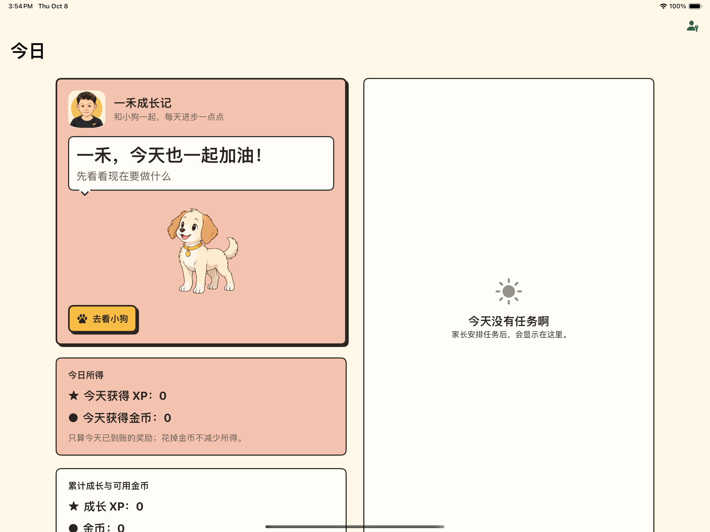

# 一禾专属视觉 · 本地实现

应用显示名称：**一禾成长记**。这是本次可逆的设计选择；内部产品名和bundle ID仍沿用Habito，以保持安装与本地数据的连续性。

## 已落地

- 根据用户提供的照片，使用imagegen生成头像；用户最终明确选择第一版彩色漫画肖像，替换之前的简化线稿。保留短发、脸型和微笑，以奶油底、深色墨线和金色圆形呼应现有漫画UI。
- 应用图标：`Manga.xcassets/AppIcon.appiconset`，1024×1024、无透明通道；Xcode实际产出iPad图标与CFBundleIcons配置。
- 应用内头像：`YihePortrait.imageset`，384×384，供首页/资料页共享；装饰图不重复朗读，品牌文字使用语义字号。
- 儿童首页：品牌头像、名称、成长短句以及“一禾，今天也一起加油！”问候；保留小狗陪伴与任务入口。
- 资料页：同一品牌头像/名称，仍通过原保存流程维护昵称和小狗名字，不自动重写记录。

## 资源与隐私边界

原照片未复制进项目；图标只使用重新绘制的头肩形象，不含座椅、票据或条码。生成源保留在工具输出目录，应用引用的最终资源已复制到工程，不依赖临时路径。

本轮包含孩子的姓名和专属形象，按AGENTS“不提交个人标识”的约束仅本地实现，不创建Git提交、不推送。已有未归属Localizable格式/提取元数据及.playwright-mcp缓存保持原状。

## 验证

实际UI覆盖普通横屏与最大辅助字号深色：品牌名称/问候、家长PIN后资料入口、输入保存、小狗页面刷新与跨进程重开。完整单测、资源和构建结果见[结构化证据](personalization/verification.json)。

SwiftUI专项复核：组件只负责展示，无业务写入；头像为装饰并隐藏重复读屏，标题/说明使用可换行语义字体，MAX缩小装饰图让出文字空间；没有新增动画或交互热区，不引入UIKit、依赖或新系统专属API。

截图是隔离模拟器中的测试数据，不代表正式家庭资料。profile-ios17.png保留为头像替换前的布局验收证据，不代表最终形象。
