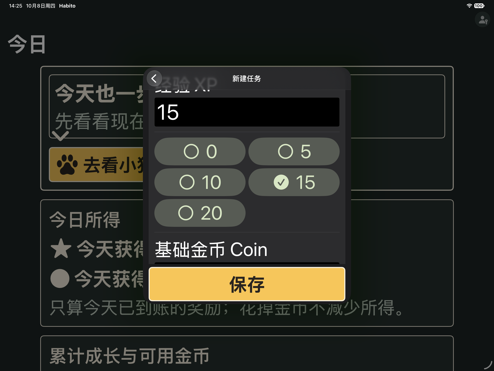

# 任务创建优化验收 · 2026-10-08

新增UX-001/002/003三卡已完成，原总进度仍6/7。范围是保存栏、九种任务建议、星期和奖励按钮，以及[习惯与奖励方案](Habito-习惯与奖励方案.md)。没有迁移正式家庭库或变更宠物消费规则。

## 最终结果

| 验证 | 结果 | 原生证据 |
|---|---|---|
| 编辑状态相关单测 | 17定义通过，含9种模板只改草稿、保留时间、无写库/通知副作用；可修改后保存回读；旧任务拒绝套用 | `/tmp/habito-ux002-unit17.xcresult` |
| iPadOS17.2普通横屏UI | 2/2通过，退出0 | `/tmp/habito-ux002d-17.xcresult` |
| iPadOS27 MAX深色横屏UI | 2/2通过，退出0 | `/tmp/habito-ux002d-27.xcresult` |
| 17.2完整单测 | 689定义、1392执行、87套件通过，零失败/跳过，退出0 | `/tmp/habito-ux-final-unit17b.xcresult` |
| 27完整单测 | 同上 | `/tmp/habito-ux-final-unit27.xcresult` |
| 最终Release构建/Debug分析 | 通过，退出0 | `/tmp/habito-ux-release-final.log`、`/tmp/habito-ux-analyze-final.log` |
| 严格格式、工程格式、资源键、diff | 通过；原467键翻译保持 | `/tmp/habito-ux-format-final.log`、结构化记录 |

[结构化证据](task-creation/verification.json)保留精确包名、原失败和最终源码边界。259个参数化定义执行962次，其余430次，合计1392次。全量长UI上一阶段已完成，本轮按DEC-030只跑与改动直接相关的两条真实闭环，不冒称重跑全部69条。

两条UI测试分别验证：

- 阅读预设替换新建草稿、上学日/周末切换、三组金额按钮、44pt点击目标、保存及跨进程重开精确回读；编辑旧任务没有模板入口。
- 空奖励、超界整数、金币合计溢出、纠正输入、真实保存；获得焦点不能改变金额；每次输入前后Form与保存栏不交叠。

## 真实发现和修复

1. 截图中的保存栏遮挡：Form与SaveBar改为垂直独立分配空间。UX001两系MAX实际输入/键盘/保存先各1/1通过，本轮最终UI继续保留几何断言。
2. 新模板区让名称输入框在MAX首屏之外；原测试入口先等待名称存在而不滚动，已改为滚动到完整可见。新测试重启错误调用创建PIN辅助方法，已改已有PIN解锁。这两项是测试修订。
3. 数字按钮的原生Label在窄栏自动隐藏文字，直接模拟器截图发现；强制titleAndIcon并增加大字号最小宽度，数字和选择标记完整可见。
4. 17系同一Form行内点击输入框会触发快捷金额，焦点断言确认0变15；输入与按钮改为独立Form行。原失败包保留，最终两系实际输入和保存均通过。
5. 完整单测发现旧宠物条件文案误提取为默认表两个空键；改为分别显式指定UIR1的静态分支，清理本轮生成的空键，扩展目录测试覆盖Localizable/UIR1。仅这一个宠物文案写法与目录单测发生在d包UI后，任务编辑器源码未变；最终两系完整单测和构建重新通过。

仅在实际测试结束后中断部分失败包的600秒可选simctl诊断；原失败退出65保留。最终d包、最终单测自然结束为0。两系字号和外观恢复为large/light。

## SwiftUI专项复核

按swiftui-pro复核数据流、视图、无障碍和代码卫生。模板应用在MainActor页面状态，View只转发意图；星期/金额按钮只改Binding，不保存或发奖。纯值规则不访问系统时间或数据库。奖励保留原文输入，以便空值、负数、小数、超界可反馈而非静默归零，沿用已有严格解析。

新组件独立文件、中文说明、预览、语义字体、至少44pt目标、选中图标和VoiceOver金额标签；MAX网格换行。没有新动画、UIKit或第三方依赖。无新增Swift/严格并发警告，原R-009方向兼容提示和无AppIntents依赖的构建元数据跳过继续记录。

## 实际截图与边界

截图为最终d包UI期间simctl直接横屏采集，2752×2064原图，未旋转或修图。XP标题上缘在正常滚动区域之外；金额按钮完整可见，保存栏独占底部空间。

上学日快捷集合为周一至五，未导入学校校历；放假覆盖沿用现有规则，临时补课不自动补排。学期/学年阶段是可观察的培养方案，未增加自动成就或跨学期数据库。目标实机、VoiceOver现场及至少14天家庭观察仍依原任务清单后置。
